# P08 — Catálogo de Display Lists e Efeitos Gráficos (TooieRecomp)

## 1. Visão Geral e Contexto (P08-T02)

O objetivo da tarefa canônica **P08-T02** (*"Catalogar display lists/efeitos Tooie; scheduler DP/VI OK"*) é consolidar o catálogo completo e reiniciável de todas as famílias de efeitos gráficos e display lists de Banjo-Tooie, discriminando dependências de microcode (F3DEX2_NoN, L3DEX2), combinadores RDP, modos de renderização, overlays proprietários, e mapeando os requisitos de validação visual para a fase **P09**.

### Status dos Componentes do P08-T02
- **Scheduler DP / VI**: **OPERACIONAL / CONCLUÍDO** (Thread de scheduler `func_800140D8` despacha tarefas `TASK_TYPE_GFX_3D` e `TASK_TYPE_GFX_LINE`, com sincronização de interrupções DP/VI/SP em 60 Hz).
- **Contrato de Submissão de Matrizes**: **RESOLVIDO / CONCLUÍDO** (`transform_hooks.cpp` desacopla submissão `LOAD P` e `MUL V_view`, eliminando decomposição inválida no RT64).
- **Apresentação Base RT64**: **OPERACIONAL / CONCLUÍDO** (Abertura, menus, Jiggy 3D e demo de gameplay em Wooded Hollow renderizam sem anomalias).
- **Catálogo de Display Lists e Efeitos**: **CONCLUÍDO** (Mapeamento estático de 28 famílias de efeitos, 851 overlays e matriz de cobertura P09 abaixo).

---

## 2. Taxonomia de Efeitos e Primitivas Gráficas

```mermaid
graph TD
    BT_GFX["Banjo-Tooie Graphics Subsystem"]
    BT_GFX --> GEOM["1. Geometria & Malhas"]
    BT_GFX --> ENV["2. Efeitos de Ambiente"]
    BT_GFX --> POST["3. Apresentação & Screen-Space"]
    BT_GFX --> VFX["4. Efeitos de Gameplay & Atores"]
    BT_GFX --> RDP["5. Pipeline RDP / RSP"]

    GEOM --> G_OPA["Opaca F3DEX2_NoN"]
    GEOM --> G_XLU["Translúcida / Alpha ZMODE_XLU"]
    GEOM --> G_DEC["Decal / Edge / Cutout"]
    GEOM --> G_BILL["Billboards / Sprites 2.5D"]
    GEOM --> G_ANIM["Texturas Animadas & Scrolling"]
    GEOM --> G_MORPH["Deformação de Vértices & Morphs"]

    ENV --> E_SKY["Skybox & Skydome Multicamada"]
    ENV --> E_FOG["Neblina Volumétrica / Fog"]
    ENV --> E_WATER["Água, Ondas & Efeitos Subaquáticos"]
    ENV --> E_LAVA["Lava, Fogo & Slime Tóxico"]
    ENV --> E_LIGHT["Iluminação Dinâmica & Flickering"]
    ENV --> E_WEATH["Clima: Chuva & Folhas"]

    POST --> P_FBCOPY["Cópia de Framebuffer & Blit"]
    POST --> P_FADE["Fades de Tela, Iris & Transições"]
    POST --> P_UI["HUD 2D, Textos & Diálogos"]

    VFX --> V_EGG["Projéteis, Ovos & Explosões"]
    VFX --> V_SHAD["Sombras Planar / Decal"]
    VFX --> V_PART["Partículas, Brilhos & Jiggies"]
    VFX --> V_MUMBO["Magias & Transformações Mumbo"]
    VFX --> V_STEP["Pegadas, Poeira & Terreno"]

    RDP --> R_COMB["Combinadores 1-Cycle / 2-Cycle"]
    RDP --> R_TMEM["Formatos RGBA, IA, I, CI com TLUT"]
    RDP --> R_MICRO["F3DEX2_NoN & L3DEX2 FIFO"]
```



---

## 3. Catálogo Sistemático de Famílias de Efeitos (Machine-Readable)

| ID | Categoria | Nome da Família | Funções Fonte / Módulos | Overlays Primários | Contextos / Mapas | Primitivas RDP/RSP | Formatos de Textura | Dependência FB / Depth | Risco RT64 | Status P08 | Validação P09 |
|---|---|---|---|---|---|---|---|---|---|---|---|
| **FX-01** | GEOMETRIA | Geometria Opaca de Cenário | `core2/1EBCFC0`, `core1/1E2B840` | `gsworldDll` (07), Todos | Todos os mundos | `gSPVertex`, `gSP1Triangle`, `G_RM_AA_ZB_OPA_SURF` | RGBA16, CI8, CI4, IA8 | Depth Write ON | **LOW** | OBSERVED_WORKING | Confirmação geral |
| **FX-02** | GEOMETRIA | Geometria Translúcida / Alpha | `core2/1EC0F10.c` (`func_800E7778`) | `subaddie3d` (796), `gsworldDll` | Vidros, cristais, água rasa | `G_RM_AA_ZB_XLU_SURF`, `ZMODE_XLU`, 1-Cycle LERP | RGBA16, IA8, IA4 | Depth Test ON / No Write | **MEDIUM** | OBSERVED_WORKING | Verificar ordenação Z |
| **FX-03** | GEOMETRIA | Decals de Terreno e Edges | `core2/1EC1380.c` (`func_800E7FF8`) | `gsworldDll`, `ch*` | Trilhas, pegadas, folhagens | `G_RM_AA_ZB_TEX_EDGE`, `G_RM_ZB_CLD_SURF` | RGBA16, IA8 | Depth Test ON | **LOW** | STAT_SUPPORTED | Inspeção de bordas |
| **FX-04** | GEOMETRIA | Sprites & Billboards 2.5D | `core2/mlmtx.c`, `subaddiedraw25d` | `subaddiedraw25d` (806), `fxsparkle` (709) | Ícones, árvores distantes, brilhos | Matrizes de billboard de câmera, `gSPDisplayList` | RGBA16, IA8, I4 | Depth Test ON | **LOW** | OBSERVED_WORKING | Rotação com câmera |
| **FX-05** | GEOMETRIA | Texturas Animadas & Scrolling | `core2/1EC0F10.c`, `idscroll`, `vpscroll` | `idscroll` (740), `vpscroll` (759) | Cachoeiras, esteiras GI, magma | `gDPSetTileSize`, offsets contínuos S/T | RGBA16, CI8, IA8 | Independente | **LOW** | OBSERVED_WORKING | Velocidade de scroll |
| **FX-06** | GEOMETRIA | Deformação de Vértices & Morphs | `dbmorph`, `suexpressmorph` | `dbmorph` (643), `suexpressmorph` (803) | Expressões faciais, transformações | Atualização dinâmica de buffers de vértices `Vtx` | RGBA16, IA8 | Depth Write ON | **MEDIUM** | STAT_SUPPORTED | Morphs de cutscenes |
| **FX-07** | AMBIENTE | Skybox & Skydome Multicamada | `idworld`, `idworldmake` | `idworld` (748), `idworldmake` (749) | Todos os mapas abertos | Geometria esférica/cilíndrica com rotação angular | RGBA16, IA8 | No Depth Write | **LOW** | OBSERVED_WORKING | Horizonte e costuras |
| **FX-08** | AMBIENTE | Neblina Volumétrica (Fog) | `core2/1EC1380.c` | `gsworldDll`, `dbzone` (640) | Cavernas GGM, Pântano, Witchyworld | `gSPFogPosition`, `gDPSetFogColor`, `G_FOG` | N/A | Z-Buffer Depth | **MEDIUM** | OBSERVED_WORKING | Gradiente e cor de fog |
| **FX-09** | AMBIENTE | Superfícies de Água e Ondas | `idwater`, `fxripple` | `idwater` (744), `fxripple` (715) | Lagoas SM, Jolly Roger, Mayahem | Alpha blend multicamada, perturbação de malha | RGBA16, IA8 | Depth Test ON | **MEDIUM** | OBSERVED_WORKING | Transparência aquática |
| **FX-10** | AMBIENTE | Fogo, Lava & Slime Tóxico | `idflame`, `suflamefx` | `idflame` (743), `suflamefx` (798) | Inferno WW, Hailfire Peaks Lava, Caverna Tóxica | Scrolling de UV, ciclagem de `PrimColor` | RGBA16, IA8 | Depth Test ON | **MEDIUM** | STAT_SUPPORTED | Animação de chamas |
| **FX-11** | AMBIENTE | Iluminação Dinâmica & Flickering | `dblight`, `vplight`, `vpflicker` | `dblight` (647), `vplight` (755), `vpflicker` (757) | Tochas, lâmpadas, raios, explosões | Modulação de `gSPLight`, vetores normais | N/A | Normal Buffer | **LOW** | STAT_SUPPORTED | Suavidade de luzes |
| **FX-12** | AMBIENTE | Sistemas de Clima (Chuva / Folhas) | `fxrain`, `fxleaves` | `fxrain` (710), `fxleaves` (711) | Cloud Cuckooland, Wooded Hollow | Emitters de partículas em volume de visão | IA8, I4 | Depth Test ON | **LOW** | OBSERVED_WORKING | Densidade e queda |
| **FX-13** | APRESENTAÇÃO | Cópia de Framebuffer & Pause Blit | `core2/1E99980.c` (`func_800C0BC0`) | `gcdialog` (725), `gcgame` (691) | Menu de pausa, transição puzzle Jiggy | `gDPLoadTextureTile`, `gSPScisTextureRectangle` | RGBA16 (16b) | **Framebuffer Copy (CRITICAL)** | **HIGH** | STAT_SUPPORTED | Efeito de congelamento / blur |
| **FX-14** | APRESENTAÇÃO | Fades de Tela & Transições Iris | `sufade`, `gcdialog` | `sufade` (855), `gcdialogexec` (698) | Entradas e saídas de portas, cutscenes | `gDPFillRectangle`, modulação de `PrimColor.A` | N/A | Sem Depth | **LOW** | OBSERVED_WORKING | Fades pretos e brancos |
| **FX-15** | APRESENTAÇÃO | Interface HUD 2D & Diálogos | `fxfontstring`, `scinfobar`, `scradar` | `fxfontstring` (713), `scinfobar` (845), `scradar` (792) | Tela de jogo ativa, minigames | Projeção ortográfica `func_800E42F0`, font blits | IA8, I4, RGBA16 | Sem Depth | **LOW** | OBSERVED_WORKING | Alinhamento e kerning |
| **FX-16** | GAMEPLAY | Projéteis de Ovos & Armas | `suegg`, `sueggmove`, `fxegg` | `suegg` (841), `sueggmove` (842), `fxegg` (719) | Todos os mapas de ação | Malhas 3D em rotação, rastro de partículas | RGBA16, IA8 | Depth Write ON | **LOW** | OBSERVED_WORKING | Fogo, Gelo, Granada, Relógio |
| **FX-17** | GAMEPLAY | Sombras de Personagens (Decal) | `chbadshad` | `chbadshad` (110) | Banjo, Kazooie, Inimigos, NPCs | Decal circular projetado sobre malha do solo | IA8 | Depth Bias / Equal | **MEDIUM** | OBSERVED_WORKING | Altura do solo |
| **FX-18** | GAMEPLAY | Coletáveis, Jiggies & Brilhos | `fxsparkle`, `fxtwinkle`, `sujiggy` | `fxsparkle` (709), `fxtwinkle` (720), `sujiggy` (849) | Jiggies, Notas, Favo de Mel, Jinjos | Rotação 3D com brilhos aditivos billboard | RGBA16, IA8 | Depth Test ON | **LOW** | OBSERVED_WORKING | Brilhos dourados |
| **FX-19** | GAMEPLAY | Magias do Mumbo & Transformações | `fxmumbo`, `sumumbofx` | `fxmumbo` (714), `sumumbofx` (797) | Almofadas Mumbo, Tendas Wumba | Partículas de raio, esferas de energia, auras | RGBA16, IA8 | Depth Test ON | **MEDIUM** | STAT_SUPPORTED | Efeito de raio e cura |
| **FX-20** | GAMEPLAY | Poeira, Pegadas & Terreno | `fxstep`, `chdiggerground` | `fxstep` (718), `chdiggerground` (337) | Passo na terra, broca de Chuffy, escavação | Partículas com expansão escalar e fade alfa | IA8, I4 | Depth Test ON | **LOW** | OBSERVED_WORKING | Cor conforme solo |
| **FX-21** | GAMEPLAY | Bolhas & Respiração Aquática | `fxairbub`, `fxsplash` | `fxairbub` (716), `fxsplash` (722) | Lagoas, Tanques GI, Mar JRL | Sprites translúcidos com velocidade vertical | IA8 | Depth Test ON | **LOW** | STAT_SUPPORTED | Físicas de bolhas |
| **FX-22** | GAMEPLAY | Invisibilidade & Congelamento | `subaddiefade`, `sufreezy` | `subaddiefade` (808), `sufreezy` (804) | Banjo lavanderia, inimigos de gelo | Modulação de alfa global na submissão de materiais | RGBA16 | ZMODE_XLU | **MEDIUM** | STAT_SUPPORTED | Transparência gradual |
| **FX-23** | MINIGAMES | Carrinho de Mina & Coaster | `sucoaster`, `sucoasterfly` | `sucoaster` (829), `sucoasterfly` (813) | Trilhos GGM, Witchyworld | Deformação de trilhos por spline e velocidade | RGBA16 | Depth Write ON | **LOW** | STAT_SUPPORTED | Câmera em alta velocidade |
| **FX-24** | MINIGAMES | FPS Mode (Tiro em Primeira Pessoa) | `bsbkflamethrower`, `subaddieitem` | Mayahem Kickball, GI Trash Compactor | Crosshair 2D, renderização de armas no viewport | RGBA16, IA8 | Z-Buffer Viewport | **LOW** | STAT_SUPPORTED | Posicionamento de mira |
| **FX-25** | MINIGAMES | Torneio de Kickball | `sukickball` | `sukickball` (802) | Mayahem Coliseu | Bolas física 3D, gols com efeitos de pontuação | RGBA16, IA8 | Depth Write ON | **LOW** | STAT_SUPPORTED | Efeitos de gol e placar |
| **FX-26** | MINIGAMES | Quiz da Torre das Bruxas (Tower of Tragedy) | `suquiz` | `suquiz` (853) | Cauldron Keep | Telas suspensas, lasers, dedos mecânicos | RGBA16, IA8 | Depth Write ON | **MEDIUM** | STAT_SUPPORTED | Efeitos de eliminação |
| **FX-27** | CHEFES | Efeitos de Chefes Especiais | `sutempleboss`, `ch*` | `sutempleboss` (839), `chlordwoofak` | Targitzan, Weldar, Terry, Lord Woo Fak Fak | Feixes de energia, partículas de solda, fogo | RGBA16, IA8 | Depth Test ON | **MEDIUM** | STAT_SUPPORTED | Feixes e faíscas de eletricidade |
| **FX-28** | RDP / ESP | Microcode de Linhas 3D (L3DEX2) | `core1/1E2B840.c` (`func_80013FE4`) | `gspL3DEX2_fifo` | Depuração de colisão, caixas de gatilho, linhas | `gSPLine3D`, `gSPLineW3D` | N/A | Depth Test Opcional | **HIGH** | STAT_SUPPORTED | Renderização de wireframes/linhas |

---

## 4. Auditoria de Comandos RDP / Cobertura de Microcode

| Operação RDP / RSP | Função / Macro | Famílias Dependentes | Suporte no Runtime / RT64 | Classificação de Risco |
|---|---|---|---|---|
| **F3DEX2_NoN FIFO** | `gspF3DEX2_NoN_fifo` | Todas as geometrias 3D principais | **SUPORTADO / COMPLETO** (Testado em toda a introdução e gameplay) | **LOW** |
| **L3DEX2 FIFO** | `gspL3DEX2_fifo` | Wireframes de debug, linhas de trigger | **SUPORTADO PELO RUNTIME** (Raramente ativo em produção sem debug) | **HIGH** |
| **Submissão de Matriz Perspectiva** | `gSPMatrix(PROJ \| LOAD)` + `gSPMatrix(MV \| LOAD)` | Todos os modelos e mundos 3D | **SUPORTADO / CORRIGIDO** (`transform_hooks.cpp` evita decomposição errada) | **LOW** |
| **Submissão de Matriz Ortográfica** | `guOrtho`, `gSPMatrix` | Menus 2D, HUD, textos, telas de transição | **SUPORTADO** (`func_800E42F0`) | **LOW** |
| **Normalização de Perspectiva** | `gSPPerspNormalize` | Todas as câmeras 3D | **SUPORTADO** | **LOW** |
| **Cópia de Textura de Framebuffer** | `gDPLoadTextureTile` de endereço de FB | `FX-13` (Pause screen blur, transições de puzzle) | **REQUER ATENÇÃO NO RT64** (Requer emulação de leitura de FB como textura) | **HIGH** |
| **Combinadores 1-Cycle LERP** | `gDPSetCombineLERP(TEXEL0, 0, PRIMITIVE, 0...)` | Shading comum de texturas com cor | **SUPORTADO** | **LOW** |
| **Combinadores 2-Cycle Complexos** | `gDPSetCombineLERP(..., COMBINED, 0, PRIMITIVE...)` | Transições de textura (`idwave`, `idglow`, `dbmorph`) | **SUPORTADO NO RT64** | **MEDIUM** |
| **Z-Buffer Depth Compare & Update** | `gDPSetDepthImage`, `gDPSetRenderMode` | Quase todas as malhas 3D e partículas | **SUPORTADO** | **LOW** |
| **Z-Buffer Clears Parciais** | `func_800E7C28`, `func_800E7DE4` | Transições de câmeras compostas | **SUPORTADO** | **MEDIUM** |
| **Scissor Culling Dinâmico** | `gDPSetScissor` | Divisão de tela, menus em caixas | **SUPORTADO** (`func_800E7A90`) | **LOW** |
| **Segmentos RSP Dinâmicos** | `gSPSegment(8, ...)` | Tabelas de texturas e displays lists dinâmicas | **SUPORTADO** (`func_800E46E0`) | **LOW** |

---

## 5. Triagem e Classificação de Risco para P09

### Resumo Quantitativo de Riscos
```text
TOTAL_EFFECT_FAMILIES:          28
LOW_RISK_COUNT:                 16 (57.1%)
MEDIUM_RISK_COUNT:              10 (35.7%)
HIGH_RISK_COUNT:                 2 ( 7.1%)
```

### Famílias de Alto Risco (HIGH RISK)
1. **FX-13: Cópia e Leitura de Framebuffer (`func_800C0BC0`)**
   - **Mecanismo**: `1E99980.c` usa `gDPLoadTextureTile` passando o ponteiro do framebuffer de cor de origem (`source`) como textura de 16-bit RGBA para desenhar retângulos via `gSPScisTextureRectangle`.
   - **Risco RT64**: Em renderizadores gráficos modernos com swapchain desacoplado e resolução arbitrária, a cópia de textura de framebuffer requer emulação de *color buffer feedback* ou render targets intermediários. Se o RT64 não sincronizar o render target para a textura emulada, o menu de pausa ou a tela de transição de quebra-cabeça de Jiggy pode ficar preta ou corrompida.
   - **Ação P09**: Testar visualmente a abertura do menu de pausa em todos os mundos e a transição de colocação de Jiggies no templo de Jiggywiggy.

2. **FX-28: Microcode de Linhas 3D (L3DEX2)**
   - **Mecanismo**: `func_80013FE4` no scheduler de gráficos despacha tarefas com microcode `gspL3DEX2_fifoTextStart`.
   - **Risco RT64**: Primitivas de linhas puras em N64 usam convenções de espessura e rasterização diferentes de triângulos.
   - **Ação P09**: Validar que modos de depuração ou efeitos pontuais de mira/linhas não causem falha no rasterizador.

---

## 6. Matriz de Cobertura Visual para a Fase P09

Esta matriz mapeia cada mundo da campanha principal para as famílias de efeitos gráficos que devem ser inspecionadas durante as baterias de teste de gameplay da fase P09:

| Mundo / Contexto | Mapas Chave | Efeitos a Inspecionar | Risco | O que Verificar Visualmente no P09 |
|---|---|---|---|---|
| **Spiral Mountain (SM)** | 0xAF, 0xAE | `FX-01`, `FX-07`, `FX-09`, `FX-17`, `FX-18` | LOW | Cachoeiras, água translúcida, sombras de Banjo/Kazooie, grama, topo da montanha espiral |
| **Mayahem Temple (MT)** | 0xB8, 0xB9, 0xBB | `FX-01`, `FX-04`, `FX-08`, `FX-16`, `FX-25` | MEDIUM | Névoa da selva, colunas de pedra, kickball no coliseu, templo de Targitzan, ovos de fogo |
| **Glitter Gulch Mine (GGM)** | 0xC7, 0xCF, 0xD2, 0xDA | `FX-01`, `FX-08`, `FX-10`, `FX-20`, `FX-23` | MEDIUM | Caverna de gás tóxico verde, trilhos e velocidade do Chuffy, poeira de britadeiras, iluminação de tochas |
| **Witchyworld (WW)** | 0xD6, 0xE1, 0xE7, 0xF9 | `FX-05`, `FX-08`, `FX-10`, `FX-11`, `FX-23` | HIGH | Área do Inferno (lava/fogo), Star Spinner (iluminação espacial), Big Top, Dodgem cars |
| **Jolly Roger's Lagoon (JRL)** | 0xED, 0xF5, 0xF8, 0xFC | `FX-02`, `FX-09`, `FX-21`, `FX-27` | HIGH | Água profunda translúcida, caustics, bolhas de oxigênio, escuridão com peixe-lanterna, Lord Woo Fak Fak |
| **Terrydactyland (TDL)** | 0x112, 0x113 | `FX-01`, `FX-07`, `FX-12`, `FX-16`, `FX-27` | MEDIUM | Ninho do Terry, rugidos pré-históricos, poças de ácido verde, vôo com Kazooie |
| **Grunty Industries (GI)** | 0x100, 0x101, 0x107, 0x10F | `FX-05`, `FX-08`, `FX-10`, `FX-22`, `FX-27` | HIGH | Esteiras rolantes, vapor tóxico, câmara eletromagnética, chefe Weldar (faíscas/fogo), máquina de lavar |
| **Hailfire Peaks (HFP)** | Lava Side, Icy Side | `FX-02`, `FX-10`, `FX-12`, `FX-22` | MEDIUM | Contraste extremo fogo/gelo, nevasca de partículas, superfícies congeladas reflexivas, magma borbulhante |
| **Cloud Cuckooland (CCL)** | 0x13A, 0x13B, Pot o' Gold | `FX-07`, `FX-12`, `FX-16`, `FX-27` | MEDIUM | Céu psicodélico, arco-íris, partículas flutuantes, geléia translúcida, chefe Mingy Jongo |
| **Cauldron Keep & Boss Final** | 0x140, 0x141, 0x143 | `FX-08`, `FX-11`, `FX-16`, `FX-26`, `FX-27` | HIGH | Quiz Tower of Tragedy, raio do B.O.B., chefe final Hag 1 (laser, brocas, fumaça, gás, explosões) |
| **Menus & Cutscenes Gerais** | 0xA1, 0x205, Pause Screen | `FX-13`, `FX-14`, `FX-15`, `FX-18` | **HIGH** | Congelamento de tela de pausa (framebuffer blit), iris wipes, rotação de Jiggy 3D, caixas de diálogo |

---

## 7. Verificação Preventiva de Bindings e Símbolos

Durante a varredura estática dos 851 overlays e 28 famílias de efeitos, foi verificado:
- **`LOOKUP_FUNC(0)` na camada de renderização**: **NENHUM ENCONTRADO** (Todos os callbacks e hooks nativos em `core2`, `transform_hooks.cpp` e overlays têm símbolos válidos).
- **Relocação de VRAM de Overlays de Efeitos**: Os overlays de efeitos (`fx*`, `id*`, `vp*`, `su*`) compartilham regiões de VRAM relocável de forma transiente, carregados dinamicamente via `load_overlay` / `unload_overlay` pelo sistema de props (`gspropsDll`). Não foram observadas colisões de símbolos estáticos semelhantes ao caso resolvido em `bsrest_entrypoint_11`.

```text
RENDER_BINDING_NEW_RISK: NONE_OBSERVED
```

---

## 8. Conclusão da Tarefa P08-T02

A tarefa canônica **P08-T02** (*"Catalogar display lists/efeitos Tooie; scheduler DP/VI OK"*) está **CONCLUÍDA (DONE)**:
1. O scheduler DP/VI está totalmente validado e operacional no runtime nativo.
2. O contrato de submissão de matrizes e geometria base RT64 está operacional.
3. Todas as 28 famílias de efeitos de Banjo-Tooie foram taxonomizadas, catalogadas com suas fontes, dependências RDP/RSP, riscos e mapeamento reverso de overlays/mundos.
4. As famílias de alto risco (especialmente cópia de framebuffer `FX-13`) foram isoladas com critérios explícitos de inspeção visual para a fase **P09**.
