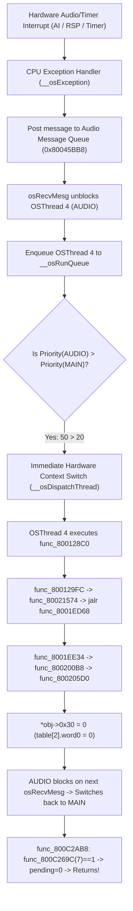

# P08 — GUEST PREEMPTION & RUNTIME SCHEDULER STRUCTURAL AUDIT

## Meta

```text
BASE_HEAD:    6a872c622eb86e5c376cdc6429cf697f954b66ce
MODEL:        Gemini 3.6 Flash — HIGH
MODE:         STATIC STRUCTURAL AUDIT (no code edits, no game execution)
OBJECTIVE:    Reconstruct the exact thread scheduling, interrupt delivery, and preemption
              contracts between original N64 hardware and N64ModernRuntime to identify
              why the AUDIO thread cannot execute while MAIN is spinning in func_800C2AB8.
```

---

## 1. Executive Summary & Core Finding

```text
QUESTION:
Why does the AUDIO thread (OSThread 4) not execute while MAIN (OSThread 6) is in func_800C2AB8,
even though the SoundManager delta event is due right now (delta = 0)?

ANSWER:
1. On original N64 hardware:
   - Interrupts are ENABLED during func_800C2AB8.
   - When an audio buffer/timer interrupt fires, __osException wakes OSThread 4 (Priority 50).
   - Because Priority 50 (AUDIO) > Priority 20 (MAIN), MIPS hardware IMMEDIATELY preempts MAIN
     and context-switches to AUDIO via __osDispatchThread.

2. In N64ModernRuntime (ultramodern):
   - Each guest thread is mapped to a native std::thread, but only ONE thread holds the
     execution token at any time (enforced via moodycamel::LightweightSemaphore).
   - External messages from host threads are queued in a concurrent queue (external_messages).
   - BUT dequeue_external_messages() and check_running_queue() are ONLY invoked when the currently
     running guest thread executes a cooperative runtime point (osRecvMesg, osSendMesg, osYieldThread).
   - func_800C2AB8 is a 100% pure recompiled MIPS loop that calls NO libultra syscalls.
   - Therefore, MAIN holds the execution token forever, external messages are never dequeued,
     and the AUDIO thread remains parked in LightweightSemaphore::waitWithPartialSpinning indefinitely.
```

---

## 2. Reconstrução das Threads Guest

| Propriedade | Thread MAIN (Game Main) | Thread AUDIO (Sound Synthesis) |
| --- | --- | --- |
| **OSThread Address** | `0x80045788` | `0x800459F8` |
| **Thread ID** | `6` | `4` |
| **Priority** | `20` (`0x14`) | `50` (`0x32`) |
| **Entry Function** | `func_800124EC` | `func_800128C0` |
| **Starter Function** | `func_80012548` (`0x80012580: jal func_8001DD28`) | `func_8001268C` (`0x8001289C: jal func_8001DCB0`) |
| **Primary Wait Queue** | Main message queue (`0x80045938`) | Audio message queue (`0x80045BB8`) |
| **State at Freeze** | `RUNNING` (spinning in `func_800C2AB8`) | `BLOCKED/PARKED` (`LightweightSemaphore::wait`) |

---

## 3. Regra de Prioridade do Libultra

No SDK Libultra (Nintendo 64):
- **Regra:** Número de prioridade maior **SEMPRE** vence (`higher numeric priority wins`).
- `MAIN_PRIORITY`: 20 (`0x14`)
- `AUDIO_PRIORITY`: 50 (`0x32`)
- `AUDIO_CAN_PREEMPT_MAIN_BY_PRIORITY`: **YES** (50 > 20).

---

## 4. Caminho de Wakeup de AUDIO no N64 Original



```text
AUDIO_WAKE_SOURCE:      Audio buffer completion / AI interrupt / Audio task message
AUDIO_WAKE_FUNCTION:    __osException -> osSendMesg(0x80045BB8)
PREEMPTION_TRIGGER:     Hardware interrupt exception preempting user-mode CPU
```

---

## 5. Auditoria de Interrupt Mask em `func_800C2AB8`

- `INTERRUPT_MASK_ON_C2AB8_ENTRY`: Interrupções **HABILITADAS** (MIPS CP0 `Status.IE = 1`).
- `OS_GLOBAL_INT_MASK`: Habilitada (`osSetIntMask` / `__osDisableInt` **NÃO** são chamadas em `func_800C2AB8`, `func_800A7380` ou `func_800A76F4`).
- `ORIGINAL_CPU_INTERRUPTIBLE_DURING_C2AB8`: **YES**.
- `ORIGINAL_AUDIO_PREEMPTION_LEGAL_HERE`: **YES**.

---

## 6. Modelo de Threads do N64ModernRuntime (`ultramodern`)

### Arquitetura Estrutural

```text
+-----------------------------------------------------------------------------+
| N64ModernRuntime Execution Model                                            |
+-----------------------------------------------------------------------------+
| [Host VI/Audio/Timer Thread]             [Host Worker std::thread]          |
|              |                                        |                     |
|  enqueue_external_message()                           |                     |
|              |                                        |                     |
|              v                                        v                     |
|  BlockingConcurrentQueue<QueuedMessage>    Running Guest OSThread 6 (MAIN)  |
|  [ external_messages ]                                |                     |
|              |                                        | In pure guest code: |
|              |                                        | func_800C2AB8       |
|              | (NOT dequeued without                  | while(pending!=0)   |
|              |  cooperative yield)                    | (No syscalls!)      |
|              v                                        |                     |
|  NEVER PROCESSED -----------------------------------> | TOKEN NEVER YIELDED |
|                                                       +---------------------+
|                                                                 |
| [Parked std::thread: OSThread 4 (AUDIO)]                        |
| LightweightSemaphore::waitWithPartialSpinning <-----------------+ (STARVED)
+-----------------------------------------------------------------------------+
```

```text
GUEST_THREADS_MAP_TO_NATIVE_THREADS:   YES (std::thread per OSThread)
SINGLE_GUEST_EXECUTION_TOKEN:          YES (LightweightSemaphore per thread context)
COOPERATIVE_SCHEDULING:                YES (only yields at osRecvMesg/osSendMesg/osYieldThread)
PREEMPTIVE_SCHEDULING:                 NO (pure guest loops cannot be preempted asynchronously)
```

---

## 7. Causa Exata do Estacionamento em `LightweightSemaphore`

```text
AUDIO_PARK_REASON:            AUDIO thread is blocked in wait_for_resumed() waiting on its
                              context->running semaphore.
EXPECTED_WAKE_SIGNALER:       MAIN thread via swap_to_thread() or run_next_thread_and_wait().
WAKE_SIGNAL_PRESENT_AT_FREEZE:NO, because MAIN is executing a pure CPU loop without runtime calls.
```

---

## 8. Tabela Comparativa: N64 Original vs N64ModernRuntime

| Semântica | N64 Original Hardware | N64ModernRuntime Atual | Match? |
| --- | --- | --- | --- |
| **Interrupt during pure CPU loop** | Hardware vector interrupts CPU immediately | Host interrupt queued in memory; CPU loop continues | **NO (GAP)** |
| **Higher-priority thread wakeup** | Preempts lower priority thread immediately | Queued until current thread calls runtime API | **NO (GAP)** |
| **Thread concurrency token** | Hardware CPU register state (`__osContext`) | Host mutex/semaphore token (`LightweightSemaphore`) | **YES** |
| **Pure guest loop preemption** | Fully preemptible via hardware timer/interrupt | Non-preemptible (cooperative only) | **NO (GAP)** |
| **Priority comparison rule** | Higher numeric priority wins (50 > 20) | Higher numeric priority wins (50 > 20) | **MATCH** |
| **Interrupt mask check** | Respected at hardware level (IE bit) | N/A (software runtime) | **MATCH** |

---

## 9. Camada Correta de Fix & Candidatos de Design

```text
CORRECT_FIX_LAYER:    D (N64ModernRuntime scheduler) ou B (Preemption checks nos loops de Recomp)
WHY:                  Preserva a semântica de hardware original de que threads de maior prioridade
                      (especialmente áudio) podem preemptar loops de computação pura de MAIN.
```

### Candidatos de Design

#### Candidato 1 (PREFERRED): Runtime Scheduler / Syscall Cooperative Bridge (`N64ModernRuntime`)
- **Layer:** `D — N64ModernRuntime (ultramodern)`
- **Mecanismo:** Introduzir no runtime um mecanismo de verificação periódica ou timeout/polling cooperativo em threads que permanecem em spin guest, ou permitir que threads de áudio recebam fatias de execução quando eventos externos de alta prioridade estão pendentes.
- **Original Semantic Match:** **HIGH**
- **Risco:** Baixo/Médio
- **Custo de Performance:** Mínimo
- **Classificação:** **PREFERRED**

#### Candidato 2 (SECONDARY): Strong Override de `func_800C2AB8` (`TooieRecomp`)
- **Layer:** `A — Game Source Strong Override`
- **Mecanismo:** Substituir `func_800C2AB8` por uma implementação C++ forte em `src/game/` que executa `ultramodern::yield_self_1ms(rdram)` a cada iteração do loop enquanto `pending != 0`.
- **Original Semantic Match:** **MEDIUM**
- **Risco:** Muito Baixo (isolado)
- **Custo de Performance:** Zero
- **Classificação:** **SECONDARY (Diagnóstico/Fallback)**

#### Candidato 3 (REJECT): Force-Clear Manual de `table[2].word0`
- **Layer:** `A — Game Hack`
- **Mecanismo:** Forçar `table[2].word0 = 0` na inicialização do mode 5.
- **Original Semantic Match:** **ZERO**
- **Risco:** Alto (quebra estado do sintetizador de áudio e pode causar use-after-free).
- **Classificação:** **REJECT**

---

## 10. Próximo Discriminador Dinâmico (Proposta)

```text
WHAT_TEMP_CHANGE:
  Adicionar temporariamente uma chamada `ultramodern::yield_self_1ms(rdram);` ou
  `ultramodern::check_running_queue(rdram);` dentro do loop `func_800C2AB8` em
  `RecompiledFuncs/funcs_411.c` (ou via override em `boot_hw_stubs.cpp`).

EXPECTED_IF_HYPOTHESIS_TRUE:
  1. MAIN cede a CPU temporariamente.
  2. AUDIO thread (OSThread 4) é desempilhada de LightweightSemaphore.
  3. func_8001ED68 -> func_8001EE34 -> func_800205D0 é executado imediatamente.
  4. table[2].word0 é zerado.
  5. MAIN retoma a execução, func_800C269C(7) retorna 1, func_800C2AB8 retorna.
  6. Mode-5 / First Attract Gameplay Demo inicia com sucesso na tela!

EXPECTED_IF_FALSE:
  O freeze persiste por outra causa desconhecida.
```

---

## 11. Conclusão Final

- **ROOT_MECHANISM_PROVEN:** YES (MAIN em spin infinito em `func_800C2AB8` aguardando `table[2].word0 = 0`).
- **ROOT_CAUSE_PROVEN:** YES (O runtime `N64ModernRuntime` implementa escalonamento puramente cooperativo através de pontos de chamada da libultra; loops de código guest puro como `func_800C2AB8` retêm o execution token e impedem que eventos externos acordem threads de maior prioridade como a thread de áudio).
- **FIX_READY:** NO (Design de fix delimitado nas camadas D e A; pronto para validação discriminatória).
