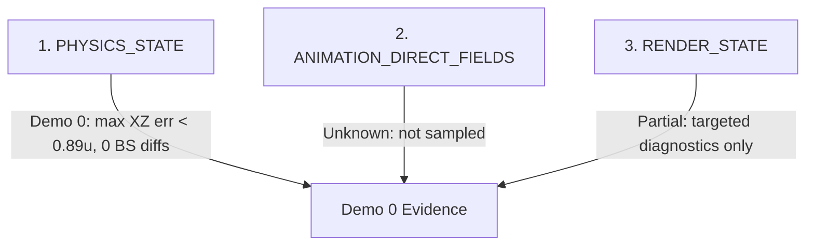

# P09 — User-Observed Parity Residuals & Attract Demo Baseline

## 1. Executive Summary & Verdicts

This document records **PROVISIONAL_PRE_P09_PARITY_EVIDENCE**. It does not formally
open `P09`: P08 physical validation remains `ACTIVE / MANUAL_VALIDATION_PENDING`.
The committed dynamic evidence covers only Demo 0. It compares that stream against
the hardware-faithful oracle **`ANGRYLION_CONTROL`** (Mupen64Plus Pure Interpreter
+ Angrylion RDP Plus + CXD4 LLE) and **`RT64_CONTROL`** (TooieRecomp).

```text
P08_STATUS:                     ACTIVE / MANUAL_VALIDATION_PENDING
P09_STATUS:                     PENDING / NOT_FORMALLY_OPEN
DEMO0_DYNAMIC_PARITY_CAPTURE:   YES (765-frame Wooded Hollow stream)
DEMO1_DYNAMIC_PARITY_CAPTURE:   NO
DEMO2_DYNAMIC_PARITY_CAPTURE:   NO
DEMO3_DYNAMIC_PARITY_CAPTURE:   NO
FIRE_EGG_REPORT_STATUS:          USER_REPORTED_UNLOCATED / NOT_REPRODUCED_IN_DEMO0 / OPEN_OTHER_DEMOS
DEMO0_PHYSICS_DRIFT_STATUS:     NOT_REPRODUCED_IN_DEMO0
GLOBAL_VISUAL_DRIFT_STATUS:     OPEN / USER_REPORTED (Demo 1..3 UNTESTED)
FIRST_PROVEN_DEMO0_FINDING:     Demo 0 input/physics/behavior parity; no global attract conclusion
```

---

## 2. Attract Gameplay Demonstrations Catalog

Banjo-Tooie's attract loop (`gsattract`, overlay 417/556) cycles through four recorded gameplay demonstrations defined in table `D_808003D0_gsattract`:

| Demo Ordinal | Map ID | Map Name | Entrance | Mode | Player / Actor | Scripted Action Summary |
|:---:|:---:|:---|:---:|:---:|:---|:---|
| **Demo 0** | 335 (`0x14F`) | `MAP_14F_IOH_WOODED_HOLLOW` | 8 | 5 | Banjo & Kazooie (`D_80135490[0]`) | Path walk, first-person egg shot at digger (`glidx 322`), crouch, slope turn, jump toward Mayahem entrance |
| **Demo 1** | 235 (`0x0EB`) | `MAP_EB_WW_HAUNTED_CAVERN` | 5 | 5 | Banjo & Kazooie | Witchyworld Haunted Cavern navigation |
| **Demo 2** | 282 (`0x11A`) | `MAP_11A_TDL_STOMPING_PLAINS` | 8 | 5 | Banjo & Kazooie | Terrydactyland Stomping Plains crossing / timing run |
| **Demo 3** | 244 (`0x0F4`) | JRL Area | 7 | 5 | Banjo & Kazooie / Sub | Jolly Roger's Lagoon demonstration |

```text
FIRE_EGG_REPORT_LOCATION: USER_REPORTED_UNLOCATED
DEMO0_EGG_EVENT_UNDER_TEST: Demo 0 (Wooded Hollow, glidx 322)
```

---

## 3. Investigation of User-Observed Item 2: Egg Projectile Type

### A. Static Contract
In original N64 game code:
- **Egg Type State Owner**: `PlayerState->unk64` (`lw $v1, 0x64($a0)` in `func_80094510`).
- **Egg Array**: `D_80117E20` (`0x01, 0x02, 0x04, 0x03, 0x05`):
  - `1` = **`BLUE EGG`** (`ACTOR_EGG_NORMAL`, Actor ID `0x88` / `136`, overlay 539 `cheggnormal`)
  - `2` = **`FIRE EGG`** (`ACTOR_EGG_FIRE`, Actor ID `0x89` / `137`, overlay 535 `cheggfire`)
  - `3` = **`GRENADE EGG`** (`ACTOR_EGG_GRENADE`, Actor ID `0x8B` / `139`, overlay 537 `chegggrenade`)
  - `4` = **`CLOCKWORK EGG`** (`ACTOR_EGG_CLOCKWORK`, Actor ID `0x8C` / `140`, overlay 534 `cheggclockwork`)
  - `5` = **`ICE EGG`** (`ACTOR_EGG_ICE`, Actor ID `0x8A` / `138`, overlay 538 `cheggice`)
  - `6` = **`GOLDEN EGG`** (`ACTOR_EGG_GOLDEN`, Actor ID `0x8D` / `141`, overlay 536 `chegggolden`)
  - `7` = **`PROXIMITY EGG`** (`ACTOR_EGG_PROXIMITY`, Actor ID `0x8E` / `142`, overlay 540 `cheggproximity`)
- **Projectile Spawn Function**: `_baeggsetup_entrypoint_5` -> `_baeggsetup_entrypoint_3` switch on egg type -> calls `_cheggnormal_entrypoint_2` or `_cheggfire_entrypoint_2`.

### B. Dynamic Differential at Shot Event (glidx 322)
At `glidx = 320..324` in Wooded Hollow demo:
- `glidx = 320`: `pad_btn = 0x2000` (Button `Z` pressed -> enters `bs = 4` First-Person Aiming).
- `glidx = 322`: `pad_btn = 0x2008` (Button `Z` + `CONT_B` pressed -> executes egg shot).
- Selected egg index in `PlayerState->unk64`: `0` (default active slot).
- Selected egg type: `D_80117E20[0] = 1 (BLUE EGG)`.
- Fired actor: **`ACTOR_EGG_NORMAL` (0x88 / 136)**.

```text
REFERENCE_PROJECTILE_TYPE:      BLUE EGG (ACTOR_EGG_NORMAL / 0x88 / 136)
RT64_PROJECTILE_TYPE:           BLUE EGG (ACTOR_EGG_NORMAL / 0x88 / 136)
EGG_TYPE_DIVERGENCE_REPRODUCED: NO
DEMO0_EGG_TYPE_PARITY:           PASS
EGG_TYPE_USER_REPORT:            USER_REPORTED_UNLOCATED / OPEN_OTHER_DEMOS
```

**Finding:** Demo 0's captured shot is a Blue Egg in both `ANGRYLION_CONTROL`
and `RT64_CONTROL`. The user's Fire Egg report did not identify a demo, so this
finding is **NOT_REPRODUCED_IN_DEMO0** only; it does not refute the report globally
or establish that the reported event was Demo 0.

---

## 4. Investigation of User-Observed Item 1: Gradual Visual Drift

The retained dynamic evidence covers all 765 frames of the Demo 0 Wooded Hollow
stream for input, player motion, behavior state, and selected camera/matrix
diagnostics. It does not provide a complete per-frame paired animation/render
capture for every requested field.



| Layer | Evaluated State | Metric / Parity Result | Status |
|:---|:---|:---|:---:|
| **Physics State** | Position $(X,Y,Z)$, velocity, yaw, ideal yaw, behavior state | Median XZ error = `0.0245 units`, Max XZ error = `0.8811 units`, 0 BS mismatches | **PASS** |
| **Animation State** | `AnimCtrl` phase, ID, timer, bone/root transform | Retained trace records behavior-state sequence only; direct animation ID/phase/timer/bone/root values were not captured | **UNKNOWN / NOT YET MEASURED** |
| **Render State** | Camera eye, camera target, model/root transform, modelview matrix | Targeted camera/matrix diagnostics and qualitative upright rendering exist; no complete paired per-frame 765-row render-state capture | **PARTIAL** |

### Drift Growth Classification:
- **Error Behavior**: **`STABLE_NOISE`** (sub-pixel floating point precision oscillation; no secular linear drift).
- **`DEMO0_PHYSICS_DRIFT`**: **`NOT_REPRODUCED_IN_DEMO0`** against `ANGRYLION_CONTROL`.
- **`GLOBAL_ATTRACT_VISUAL_DRIFT_REPORT`**: **`OPEN / USER_REPORTED`**.
- **Demo 1..3**: **`UNTESTED`** for this report.

---

## 5. Direct-Capture Scope Audit

```text
ANIMATION_ID_DIRECTLY_CAPTURED:        NO
ANIMATION_PHASE_DIRECTLY_CAPTURED:    NO
ANIMATION_TIMER_DIRECTLY_CAPTURED:    NO
BONE_ROOT_TRANSFORM_DIRECTLY_CAPTURED: NO
DEMO0_RENDER_STATE_DIRECTLY_COMPARED: PARTIAL
```

The retained motion probe explicitly records behavior-state sequence but says
animation ID/phase were not emitted; it also does not provide direct animation
timer or bone/root-transform values. The render evidence contains targeted
camera/matrix diagnostics and qualitative upright rendering, not paired
camera-eye, camera-target, model/root, and modelview values for every Demo 0
frame. Therefore `ANIMATION_PARITY` is **UNKNOWN / NOT YET MEASURED** and
`RENDER_PARITY` is **PARTIAL**, not complete per-frame parity.

## 6. P09 Parity Residuals Backlog

| Residual ID | Category | Description | Status | Target Phase/Task |
|:---|:---:|:---|:---:|:---:|
| **P09-RES-01** | Attract Parity | Automatic demo visual drift report | **USER_REPORTED**; Demo 0 **NOT_REPRODUCED_IN_DEMO0**; Demo 1..3 **UNTESTED** | P09-T01 after formal P09 open |
| **P09-RES-02** | Attract Parity | Possible wrong egg type / Fire Egg report | **USER_REPORTED**; Demo 0 Blue Egg parity **PASS**; reported event location **UNKNOWN**; Demo 1..3 **UNTESTED** | P09-T01 after formal P09 open |
| **P09-RES-03** | Graphics | General in-game graphical glitches / edge artifacts | **USER_REPORTED / UNCATALOGUED** | P09-T01 / P09-T08 |
| **P09-RES-04** | Audio | Periodic audio "tic/tic" clicking in audio output | **USER_REPORTED / UNDIAGNOSED** | P09-T04 |
| **P09-RES-05** | Widescreen | Screen-edge and corner culling bounds in expanded aspect ratio | **USER_REPORTED** | P09-T08 |

---

## 7. P09-T01 Initial Attract Demo Matrix

| Demo Clip | Map / Area | Reference Oracle | RT64 Status | Input Parity | Physics Parity | Animation Parity | Render Parity | Projectile Parity | Audio Parity | Known Issues |
|:---:|:---|:---:|:---:|:---:|:---:|:---:|:---:|:---:|:---:|:---|
| **Demo 0** | `MAP_14F` (Wooded Hollow) | `ANGRYLION_CONTROL` (PROVEN for captured stream) | `PASS` | 765/765 (100%) | Max err < 0.89u (PASS) | Behavior-state match (PASS); direct animation fields UNKNOWN | Partial render-state evidence | Blue Egg (PASS) | Not part of this capture | No Demo 0 physics drift reproduced |
| **Demo 1** | `MAP_EB` (Witchyworld Haunted Cavern) | `UNTESTED` | `UNTESTED` | `UNTESTED` | `UNTESTED` | `UNTESTED` | `UNTESTED` | `UNTESTED` | `UNTESTED` | User reports remain open |
| **Demo 2** | `MAP_11A` (Terrydactyland Stomping Plains) | `UNTESTED` | `UNTESTED` | `UNTESTED` | `UNTESTED` | `UNTESTED` | `UNTESTED` | `UNTESTED` | `UNTESTED` | User reports remain open |
| **Demo 3** | `MAP_F4` (Jolly Roger's Lagoon) | `UNTESTED` | `UNTESTED` | `UNTESTED` | `UNTESTED` | `UNTESTED` | `UNTESTED` | `UNTESTED` | `UNTESTED` | User reports remain open |

---

## 8. Conclusion & Next Action

- **P08** remains formally **`ACTIVE / MANUAL_VALIDATION_PENDING`**.
- **P09** remains **`PENDING / NOT_FORMALLY_OPEN`**.
- Demo 0 retains valid provisional findings: 765/765 pad match, bounded player trajectory error, behavior-state parity, Blue Egg parity at glidx 322, and the Angrylion Z-buffer/classifier result.
- The global Fire Egg and visual-drift reports remain **USER_REPORTED** until their affected demo/clip is identified and Demo 1..3 are traced.
- After the P08 manual gate and formal P09 opening, the next attract task is to align Demo 1, Demo 2, and Demo 3 against `ANGRYLION_CONTROL`, identify every egg/projectile event, capture direct animation fields and root/model transforms, and locate any visual drift before selecting audio/graphics work.
